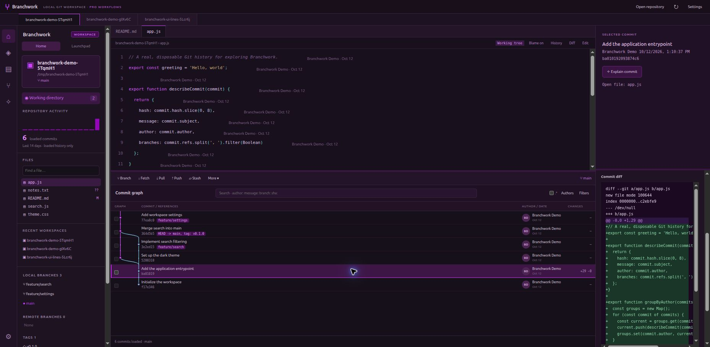
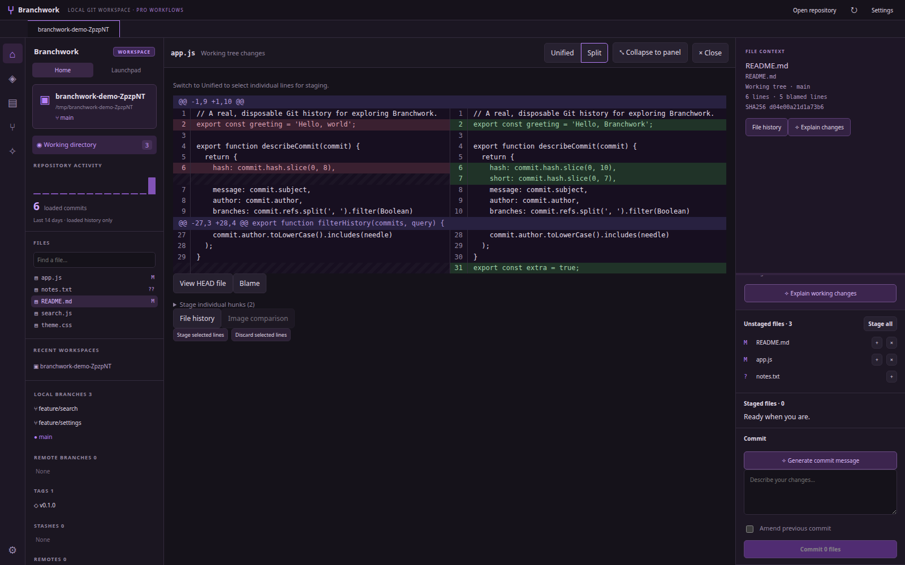
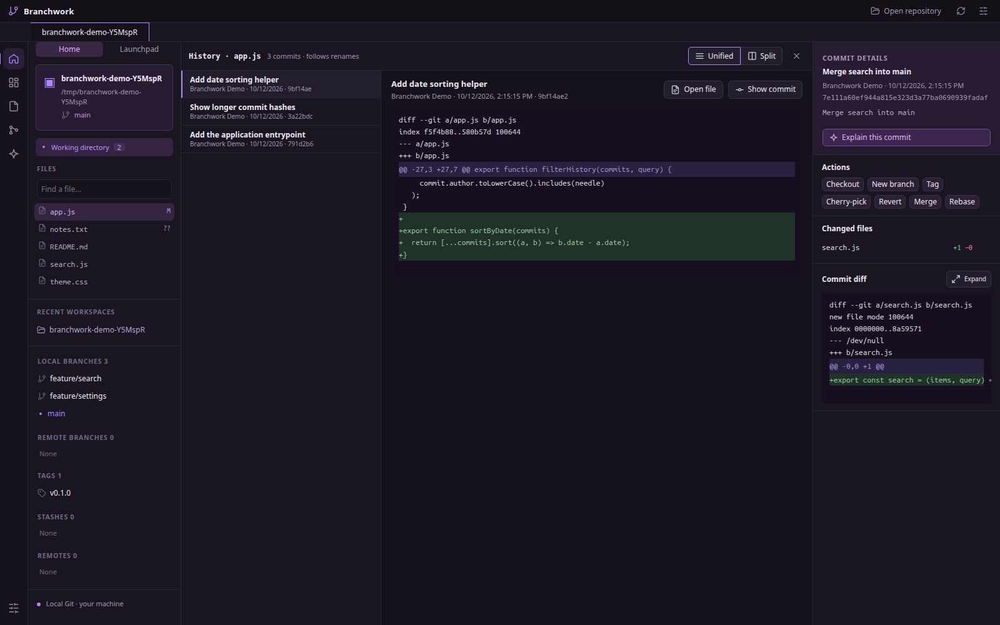
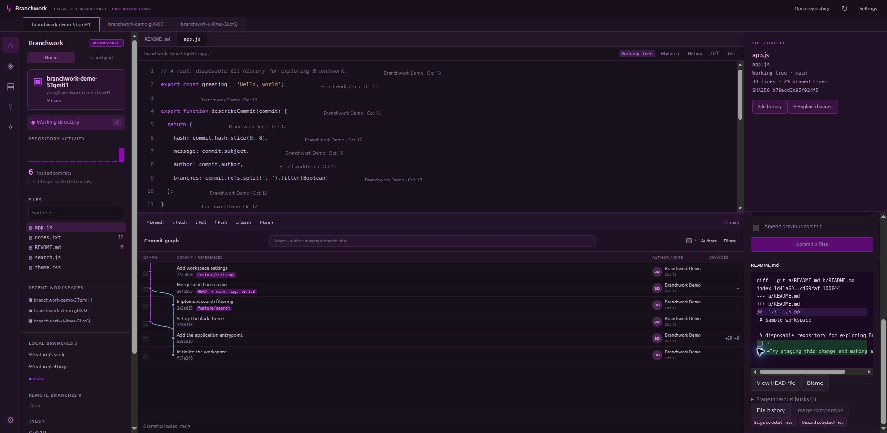
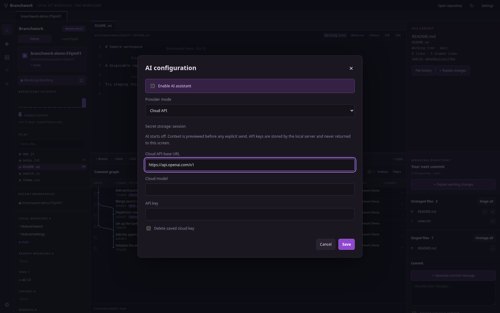
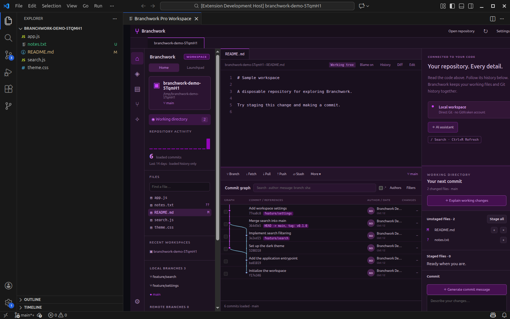

# Branchwork

A local Git workbench for **Windows, macOS, Linux and VS Code**: code, line blame, commit graphs, advanced Git workflows, and optional AI in one workspace.

[Download the latest release](https://github.com/stevenmcsorley/branchwork/releases/latest) · [Installation](#install) · [AI and MCP](#optional-ai-and-mcp) · [Feature coverage](research/FINDINGS.md)



Branchwork is an independent project inspired by GitLens-style workflows. It uses your local Git repositories and existing Git credentials. GitKraken accounts, subscriptions, cloud patches, cloud workspaces, profile sync, and vendor AI services are not required or included. This project is not affiliated with GitKraken or GitLens.

## What you can do

- **Explore your code:** editable files in closable tabs, syntax-colored text, inline blame, line-to-commit navigation, historical file versions, and image comparisons. Maximize the editor to hide the graph when you're reading code.
- **Read diffs at full width:** expand any diff over the editor and graph, switch between unified and side-by-side split views, and keep staging individual lines while expanded. File history opens full-width too, with each commit's diff of that file beside the commit list.
- **Understand your history:** parent-aware commit graph, branch/tag labels, author views, advanced search, regex search, activity summaries, commit details, custom issue autolinks, and repository tabs.
- **Work with Git:** file/hunk/line staging and unstaging, selective discard, amend, batch cherry-pick, revert, reset previews, branch/upstream management, stash/apply/pop, annotated tags, multiple pull policies, and push with optional force-with-lease.
- **Manage advanced workflows:** reorder/reword/edit/squash/fixup/drop in linear interactive rebases, merge-preserving normal rebases, conflict comparisons/resolution, Gitflow features/releases/hotfixes, worktrees, submodules, LFS controls, signing settings, and ignore rules.
- **Review hosted work:** direct GitHub, GitLab, Bitbucket Cloud, and Azure DevOps adapters for PRs/merge requests, issues/work items, comments, supported reviews, merge requests, file summaries, and checks. Launchpad groups items using provider-reported status.
- **Choose your AI:** off by default; use an OpenAI-compatible cloud endpoint with your own key, or an AI-capable MCP tool. Generate commit/stash messages, explain commits/changes, review diffs, draft PR descriptions and changelogs, or ask about the selected context.

## Install

Download installers and checksums from [Releases](https://github.com/stevenmcsorley/branchwork/releases/latest).

### Windows — x64

Download `branchwork-0.2.3-windows-x64-setup.exe` and run it. It installs for your user account; no administrator rights are needed. A portable `branchwork-0.2.3-windows-x64.zip` is also available: extract it and run `Branchwork.exe`.

[Git for Windows](https://git-scm.com/download/win) must be installed. The installer isn't code-signed yet, so SmartScreen may show **Windows protected your PC**. Choose **More info → Run anyway**.

### macOS — Apple Silicon and Intel

Download the `.dmg` for your Mac: `branchwork-0.2.3-macos-arm64.dmg` for Apple Silicon (M1 and later), or `branchwork-0.2.3-macos-x64.dmg` for Intel. Open it and drag **Branchwork** into Applications. `.zip` versions are also provided.

Git is required: run `xcode-select --install`, or install Git with Homebrew. The app is not notarized by Apple yet, so the first launch is blocked. Open it once, then go to **System Settings → Privacy & Security** and choose **Open Anyway**. Alternatively, clear the download quarantine flag:

```sh
xattr -dr com.apple.quarantine /Applications/Branchwork.app
```

### Linux desktop — Debian/Ubuntu, x64

```sh
sudo apt install ./branchwork_0.2.3_amd64.deb
```

Launch **Branchwork** from your application menu. The package includes Electron and declares system Git/library dependencies. Node.js is not required to run the packaged desktop app.

### Linux desktop — portable x64

```sh
tar -xzf branchwork-0.2.3-linux-x64.tar.gz
cd branchwork-0.2.3-linux-x64
./branchwork
```

Install Git and the GTK/NSS libraries required by Electron. The portable launcher uses Electron's sandbox when its helper has the required root ownership and permissions. If extracting the archive leaves the helper owned by your user, the launcher automatically starts the app with `--no-sandbox`. Prefer the DEB when you want the Chromium process sandbox enabled; its installer sets the helper's required ownership and permissions.

### VS Code extension

Download `branchwork-pro-workspace-0.2.3.vsix`, then use **Extensions → … → Install from VSIX**, or:

```sh
code --install-extension branchwork-pro-workspace-0.2.3.vsix
```

Open a local Git repository, then run **Branchwork: Open Workspace** from the Command Palette. The extension includes the shared backend and UI. **Branchwork: Toggle Inline Blame** adds attribution to the native editor; **Branchwork: Show Line Commit** opens the responsible commit. Git is required; a separate Node.js installation is not required for the VSIX.

### From source / web interface

Node.js 22+ and Git are required.

```sh
git clone https://github.com/stevenmcsorley/branchwork.git
cd branchwork
npm ci
npm start
# Open http://127.0.0.1:4317
```

For the desktop development version:

```sh
npx install-electron
npm run desktop
```

On Ubuntu 23.10 and later, `npm run desktop` may stop with *"The SUID sandbox helper binary was found, but is not configured correctly"*. Don't run it with `sudo`. Either start without Chromium's sandbox:

```sh
npm run desktop:compat
```

or give Electron's sandbox helper the ownership it needs, once:

```sh
sudo chown root:root node_modules/electron/dist/chrome-sandbox
sudo chmod 4755 node_modules/electron/dist/chrome-sandbox
```

The packaged `.deb` sets this up for you.

## Optional AI and MCP

Open **Settings → Configure AI**. AI starts disabled, and disabling it prevents AI requests and MCP tool discovery.

**Cloud:** enter your provider's API base URL, model name, and key. The endpoint must implement `/chat/completions`. HTTPS is required except for local HTTP providers.

**MCP tool:** select stdio or Streamable HTTP, configure the command/arguments or URL, and select an AI-capable tool. Arguments can use `{{prompt}}`, `{{context}}`, and `{{task}}`. MCP is a transport; a server must expose a generation/assistant tool to produce AI answers. Ordinary Git tools alone do not supply a language model.

Before generation, Branchwork shows the destination and exact context. Sending uses that approved snapshot; expired previews or changed settings require a fresh preview. Suggestions are displayed for review and never execute Git commands. Generated messages can be inserted into drafts; creating a commit remains a separate action.

Keys are never returned to the UI or stored in browser local storage. Desktop uses OS-backed encryption when a secure keyring is available. Otherwise keys stay in memory for the current session; configuration metadata persists with owner-only permissions. The web/VS Code versions use session keys by default. For noninteractive use, set `BRANCHWORK_AI_API_KEY` or `BRANCHWORK_PROVIDER_TOKEN` in the process environment.

### Expose Branchwork tools to another agent

The standalone MCP release bundle requires Node.js 22+:

```sh
tar -xzf branchwork-mcp-0.2.3.tar.gz
BRANCHWORK_MCP_ROOT=/absolute/path/to/your/repositories node mcp/branchwork-mcp.mjs
```

Or run `npm run mcp` from source. Configure your MCP client to launch that command. Tools include repository state, history, diffs, blame, and optional AI previews/generation. Paths must remain inside the configured root. Git write tools are not advertised unless you explicitly set `BRANCHWORK_MCP_ALLOW_WRITES=1`.

Portable plugin descriptors are included as `plugin.json` and `mcp.json`; adjust the repository root for your client. Nothing is automatically installed into your agent configuration.

## Hosting integrations

Use **Settings → Configure repository hosting** to choose a provider, API URL, repository identifiers, and your own access token. Self-hosted GitHub/GitLab-style API URLs can be configured. Azure review voting requires a reviewer ID. Your token needs permission for each requested operation; permissions are not automatically created or expanded.

Launchpad and hosting dashboards load only when requested. Creating/commenting/reviewing/merging uses explicit actions. Unsupported operations are hidden or rejected, and missing supplementary permissions produce detail warnings. Lists currently show at most 100 items; Branchwork reports when more may exist.

## Screenshots

Screenshots show the running app with generated, disposable Git repositories. No private repository contents, credentials, or fabricated hosted review results are shown.

<details open><summary>Full-width split diff</summary>



</details>

<details><summary>Full-width file history</summary>



</details>

<details><summary>Selecting individual lines to stage</summary>



</details>

<details><summary>Optional AI configuration</summary>



</details>

<details><summary>VS Code workspace</summary>



</details>

## Develop and verify

```sh
npm run check
npm test
npm run demo             # prints a new disposable repository path
npm run build:runtime    # builds shared VS Code and standalone MCP runtimes
npm run build:release    # Linux x64 portable + DEB + MCP packages
npm run build:desktop    # Windows installer/zip or macOS dmg/zip (run on that OS)
npm run package          # source archive
```

Pushing a `v*` tag runs `.github/workflows/release.yml`, which builds and smoke-tests the Linux, Windows and macOS packages on their own runners and attaches them to the GitHub release. To sign builds, add the electron-builder signing secrets (`CSC_LINK`/`CSC_KEY_PASSWORD`, plus Apple notarization credentials) to the workflow.

See [TESTING.md](TESTING.md) for verification and [the feature matrix](research/FINDINGS.md) for coverage and limits. Live hosting accounts, remote LFS traffic, and actual signing require your own credentials/tools and have not been verified against production services. AI protocol tests use local fixtures, not paid cloud calls. This is a working independent implementation, not a claim of complete GitLens/GitKraken equivalence.

The original GitKraken installer/extraction is kept out of the repository and release packages. Source is MIT licensed; bundled dependencies retain their own licenses and notices. Interface icons are adapted from [Lucide](https://lucide.dev) (ISC license).
